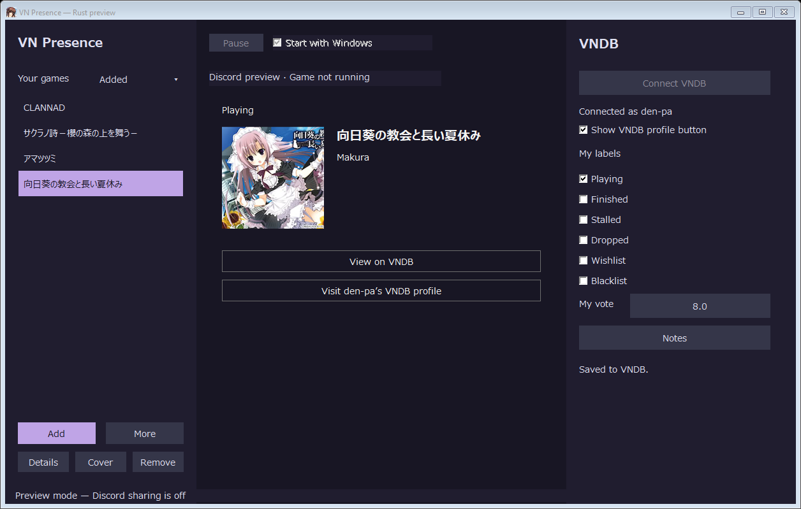
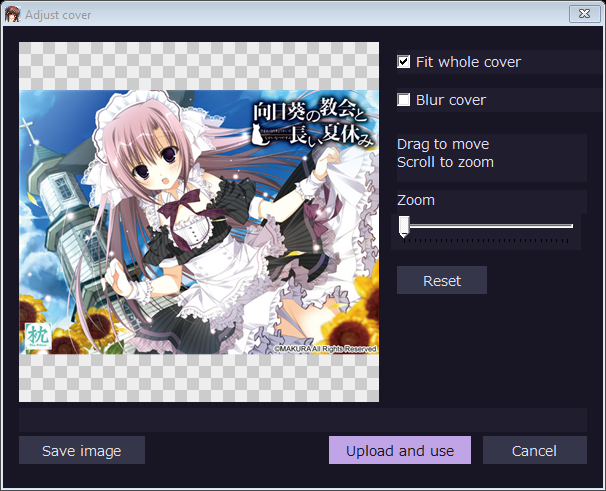
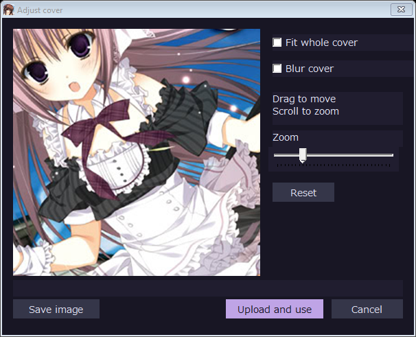
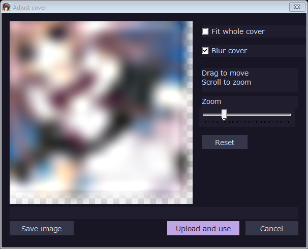

# VN Presence

A lightweight Windows app that shows the visual novel you're playing on Discord, with its title, studio, cover, chapter details and elapsed time.

**About 1.5 MB · Native Rust app · **

## Install

1. Download **VN.Presence.exe** from [Releases](https://github.com/denpa39/lightweight-vn-discord-rich-presence/releases/latest) and open it. No installer, ZIP or extra runtime.
2. Open Discord desktop and enable **Settings → Activity Privacy → Share your detected activities**.
3. Start a game and add it to your library.

Requires Windows 10 or 11, 64-bit. No Discord token or Developer Portal setup needed.

**Updating from the old .NET version?** Quit it from the tray before opening this version. Your library and preferences are copied on the first launch. The old settings file is kept. Replace the EXE in the same folder; check **Start with Windows** again if you want this version to launch at sign-in.

## Your library

Click **Add**, select the game's running window or use **Browse** to choose its executable. Search for its title or paste a VNDB URL, select the matching result, then click **Link**.

The dropdown above the library sorts by **Added**, **Alphabetical** or **Last played**. Your choice is saved; play history starts when the app records a session.

Select a game to edit its **Details** or **Cover**. Use **More → Change executable** if you move its folder. **Remove** unlinks it after confirmation.

## Discord preview and details

The center panel previews the selected game's cover, title, studio, details, timer and activity buttons. **View on VNDB** opens its game page. Start the game to see its live chapter details and timer. Discord may arrange the activity differently on desktop and mobile.

Open **Details** to choose:

- **Automatic:** use the game's window title for chapter or progress text.
- **Custom:** enter your own text, or leave it blank to hide the details line.
- **Remove text:** remove unwanted phrases, separated with `;`.
- **Window title prefix:** set the game name when it differs from VNDB's title.
- **Trim from edges:** remove surrounding characters, such as `-()`.

Check **Result**, then **Save**. Resize the dialog for longer titles. Chapter changes keep the play timer running.

## Fit the whole cover without cropping

**Fit whole cover** keeps the entire artwork visible in Discord's square image area with transparent padding. Tall or wide covers aren't stretched or cut off.

| Fit whole cover | Square crop |
| --- | --- |
|  |  |

Open **Cover**, select a cover, then **Adjust**. Tick **Fit whole cover**, click **Upload and use**, then **Save** in the cover picker. The checkerboard shows transparency and isn't part of the image. **Save image** saves a PNG on your PC.

Untick **Fit whole cover** to crop. Drag to move the image; scroll or use **Zoom** to resize it. Arrow keys move it when the preview has focus. **Reset** recenters it.

Crop and blur examples

Tick **Blur cover** to obscure artwork before uploading it. Blur works with both fit and crop; click **Upload and use**, then **Save** to apply it.

**Community covers** opens a separate list below the release covers. Reuse another user's cover without uploading it again. Uploading identical image bytes also reuses the existing image. **Custom image** accepts a direct public image URL; **Default** restores the main VNDB cover.

To undo an upload, select one marked **(your upload)** and click **Remove upload**. Confirmation deletes the hosted image, including for other people using its URL. Removal rights stay on this PC.

Uploaded images are public. Blur is optional; the app doesn't detect NSFW artwork automatically.

## VNDB labels, votes, notes and your profile

Click **Connect VNDB** in the right panel. Create a token at [VNDB Applications](https://vndb.org/u/tokens) with both permissions:

- **Access private items on my list**
- **Add/remove/edit items on my list**

Paste the token and connect. Your password stays on VNDB; Windows protects the saved token for your user account.

Select a game to load its labels and vote. Label and vote changes save automatically. Playing, Finished, Stalled and Dropped are mutually exclusive. Open **My vote** to choose a rating, or type a decimal from **1.0 to 10.0** and press Enter. **Remove vote** clears it.

Click **Notes** below the vote to edit the game's VNDB note. It saves after you pause typing. **Save and close** finishes saving before closing; clearing the text removes the note. Notes aren't shown on Discord, but follow your VNDB list privacy: notes on public entries may be visible to other people.

Wait for **Saved to VNDB** before quitting. A failed save keeps your draft; edit again to retry. For notes, **Save and close** also retries. **Disconnect** removes the saved token.

Tick **Show VNDB profile button** below your username to add **Visit [username]'s VNDB profile** to the activity. Discord hides activity buttons from their owner; other people can see them.

## Tray, startup and backups

- **Minimize** or **X** keeps the app in the tray. Double-click its icon to reopen it; right-click → **Exit** to quit.
- **Pause / Resume** controls sharing. Closing the game clears its activity.
- **Start with Windows** launches it in the tray at sign-in. Keep the EXE in the same folder.
- **More → Guide** opens the built-in guide.
- **More → Export settings / Import settings** transfers your library and preferences. Import replaces your settings after confirmation. Connect VNDB again on another PC; the token isn't exported.

For building from source, see [Rust build instructions](rust-app/README.md).
